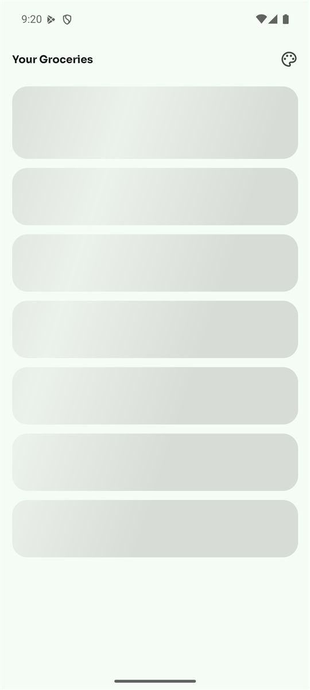
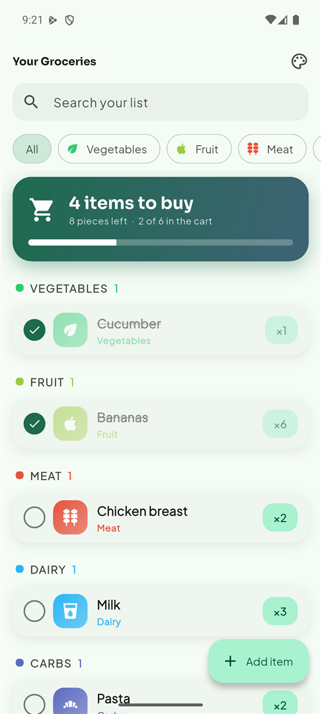
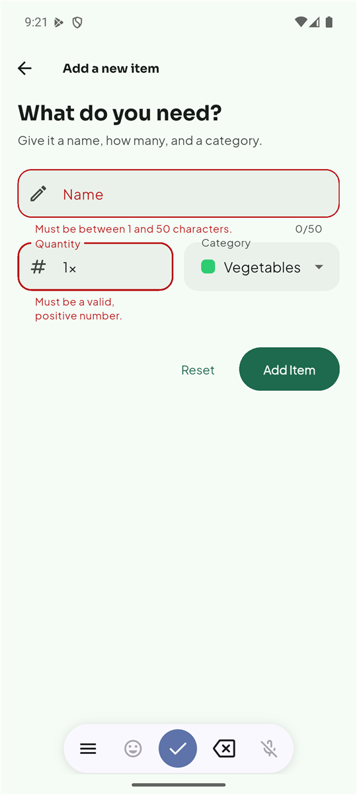
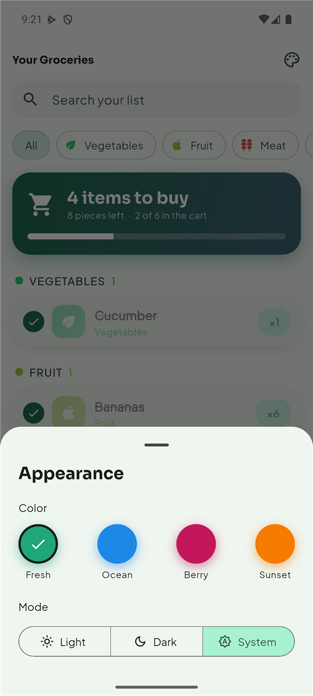
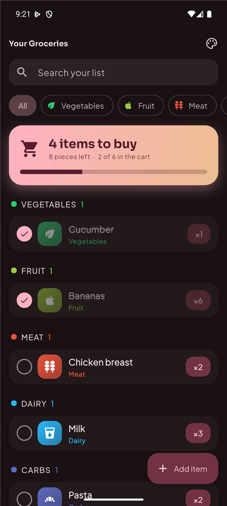

# Shopping List

A Flutter app for writing down what you need to buy: add items with a quantity and a category,
tick them off in the shop, and keep the list saved. Built for the NTNU *Mobile Applications*
course (Assignment #4).

<p align="center">
  
  
  
</p>

<p align="center">
  
  
</p>

## Features

| Assignment requirement | How it is done |
| --- | --- |
| 1. Show the list with name, quantity and category | `GroceryListScreen` + `GroceryListItem` |
| 2. Separate screen to add an item | `NewItemScreen` (pushed with a slide-up transition) |
| 3. Validate the input, show messages | `Form` + `GlobalKey`, validators on name and quantity |
| 4. Predefined categories | 10 categories in `data/categories.dart` (colors and icons) |
| 5. Remove an item (swipe) | `Dismissible`, swipe **right** to remove |
| 6. Store and retrieve through a remote source | `GroceryRepository` with a mock and an HTTP (Firebase REST) implementation |
| 7. Loading, error and empty states | shimmer skeleton, error with "Try again", empty message |
| 8. Navigation list <-> add item | `Navigator.push` / `pop` |

Extras: tick items as **bought** (crossed out, moved down, progress bar), list **grouped by
category**, **pull-to-refresh**, **search** and **category filter chips**, **editing** an item,
4 color **palettes** with light/dark/system mode, animations, Google Fonts.

## The remote data source (important)

All storage goes through one interface, `GroceryRepository` (`lib/data/grocery_repository.dart`):
`fetchItems`, `addItem`, `updateItem`, `deleteItem`. Two classes implement it:

- **`MockGroceryRepository`** (default for now): behaves like a server (async, with a small delay)
  but keeps the data on the phone with `shared_preferences`, so the list survives restarts.
- **`HttpGroceryRepository`**: talks to a **Firebase Realtime Database** over HTTP, like in the
  Udemy course:

  | Action | Request |
  | --- | --- |
  | Load all items | `GET {url}/shopping-list.json` |
  | Add an item | `POST {url}/shopping-list.json` (answers the new id) |
  | Edit / tick as bought | `PATCH {url}/shopping-list/{id}.json` |
  | Remove an item | `DELETE {url}/shopping-list/{id}.json` |

**To use the real backend**, open `lib/data/backend_config.dart`, paste the database URL into
`backendBaseUrl` and set `useMockBackend = false`. Nothing else changes: the screens only know the
interface.

The HTTP class is defensive about what it reads. An item with a missing or unknown category
becomes "Other", a text or decimal quantity is converted (bad values become 1), an item without a
name is shown as "Unnamed item", and entries that are not objects are skipped. So one odd record
never stops the whole list from loading. Categories are stored by their title ("Vegetables"),
like in the course, and read in any letter case.

## Architecture

Three layers, as in the lecture:

- **Data layer** (`lib/data`): predefined categories and everything that talks to a data source
  (`GroceryRepository`, the mock, the HTTP version).
- **Model layer** (`lib/models`, `lib/providers`): `GroceryItem`, `Categories`/`Category`,
  `GroceryGroup`, and the `ChangeNotifier`s that hold the state and the business logic.
- **UI layer** (`lib/screens`, `lib/widgets`, `lib/theme`): screens and widgets that react to the
  state and to user input, including validation, loading and errors.

```
lib/
├── main.dart                          Entry point: providers + MaterialApp (theme, mode)
├── data/
│   ├── categories.dart                The 10 predefined categories (title, color, icon)
│   ├── grocery_repository.dart        Interface + GroceryRepositoryException
│   ├── mock_grocery_repository.dart   Fake "server" stored with shared_preferences
│   ├── http_grocery_repository.dart   GET / POST / PATCH / DELETE against Firebase
│   └── backend_config.dart            The ONE place that picks mock or real backend
├── models/
│   ├── category.dart                  Categories enum + Category (title, color, icon)
│   ├── grocery_item.dart              GroceryItem (id, name, quantity, category, isBought)
│   └── grocery_group.dart             Items of one category, for the section headers
├── providers/
│   ├── grocery_provider.dart          List state, search/filter/grouping, add/edit/tick/remove
│   └── theme_provider.dart            Selected palette and light/dark mode (saved)
├── screens/
│   ├── grocery_list_screen.dart       Home: loading / error / empty / list, refresh, swipe
│   └── new_item_screen.dart           Add and edit form with validation
├── theme/
│   └── app_theme.dart                 Palettes and buildAppTheme() (Material 3 + Google Fonts)
└── widgets/
    ├── grocery_list_item.dart         One row: checkbox, icon, name, category, quantity
    ├── category_header.dart           Colored section title above a group
    ├── summary_card.dart              Gradient card with counts and a progress bar
    ├── search_and_filters.dart        Search field + category chips
    ├── grocery_skeleton.dart          Shimmer loading placeholder
    ├── state_views.dart               Empty, error and "no matches" messages
    └── theme_sheet.dart               "Appearance" bottom sheet
test/                                  Unit and widget tests
docs/screenshots/                      Screenshots used in this README
```

## How it works

**State: Provider.** `GroceryProvider` is created once in `main.dart` and starts loading
immediately. Screens read it with `context.watch` (rebuild on change) and call it with
`context.read`. Its `status` (`loading`, `loaded`, `error`) decides which view the list screen
shows (conditional rendering).

**Main methods of `GroceryProvider`**

- `load()` – fetches the items; sets `loading`, then `loaded` or `error`.
- `addItem()` / `updateItem()` – wait for the data source first, then change the list. If saving
  fails they throw, so the form stays open and shows a message.
- `toggleBought()` and `removeItem()` – *optimistic*: the list changes at once, then the data
  source is told. If that fails, the change is undone and a message is shown.
- `groups` – the visible items split per category (in enum order), bought items at the bottom.
- `setSearchQuery()`, `setCategoryFilter()` – only change what is shown, never the stored list.

**Forms.** `NewItemScreen` uses a `Form` with a `GlobalKey<FormState>`: `validate()` checks all
fields, `save()` copies the values into variables, `reset()` clears (or, when editing, restores the
item's original values). Errors update while typing (`AutovalidateMode.onUserInteraction`). Rules:
the name must have 1-50 characters, the quantity must be a positive whole number.

**Theming.** `buildAppTheme(seedColor, brightness)` builds the whole Material 3 theme from one
color, so every widget stays consistent. The chosen palette and mode are saved with
`shared_preferences`. Fonts are Sora (titles) and Plus Jakarta Sans (text); they are preloaded
before the first frame so text is measured with the real font.

## Tests

40 tests: the HTTP layer with a fake `http` client (requests, parsing, error handling, odd data),
the provider logic (counts, grouping, search, filter, rollback), and widget tests for every
screen state and interaction (loading, empty, error, validation, add, edit, tick, swipe, refresh,
search, filter chips, appearance sheet).

```bash
flutter test
flutter analyze
```

## Run the app

Requirements: Flutter SDK (Dart 3.13+).

```bash
flutter pub get
flutter run
```

The mock backend needs no setup, so the app works offline (the very first start downloads the
fonts once).

**Windows note.** If the Android build fails in `compileDebugKotlin` with "this and base files
have different roots", the project and the Pub cache are on different drives.
`android/gradle.properties` already sets `kotlin.incremental=false` to avoid this.

## Dependencies

| Package | What it does here |
| --- | --- |
| [`http`](https://pub.dev/packages/http) | Sends the GET / POST / PATCH / DELETE requests to the backend |
| [`provider`](https://pub.dev/packages/provider) | Shares the list and theme state with every screen (`ChangeNotifier`) |
| [`google_fonts`](https://pub.dev/packages/google_fonts) | Sora and Plus Jakarta Sans without bundling font files. Pinned to 6.3.3 because 9.x needs the newer `material_ui` package, which doesn't match this Flutter SDK |
| [`shared_preferences`](https://pub.dev/packages/shared_preferences) | Stores the mock list, the palette and the mode on the device |
| [`flutter_animate`](https://pub.dev/packages/flutter_animate) | Short declarative animations (fade, slide, scale) |
| [`shimmer`](https://pub.dev/packages/shimmer) | The moving shine on the loading skeleton |
